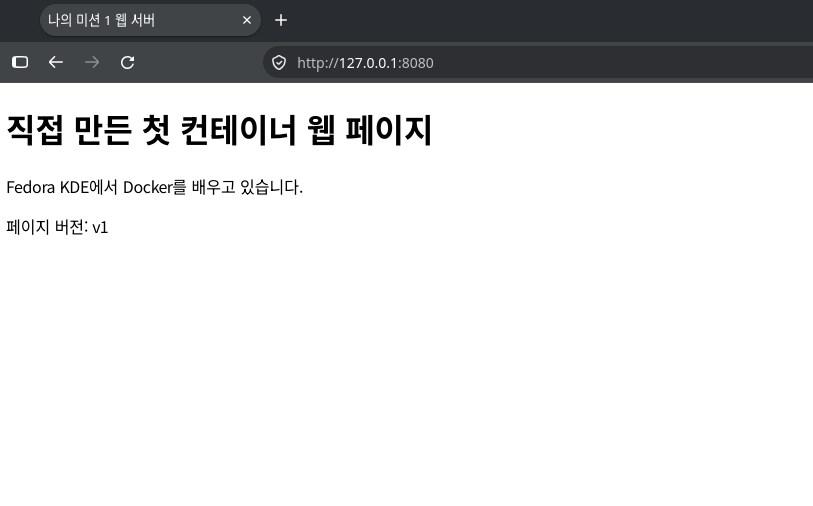
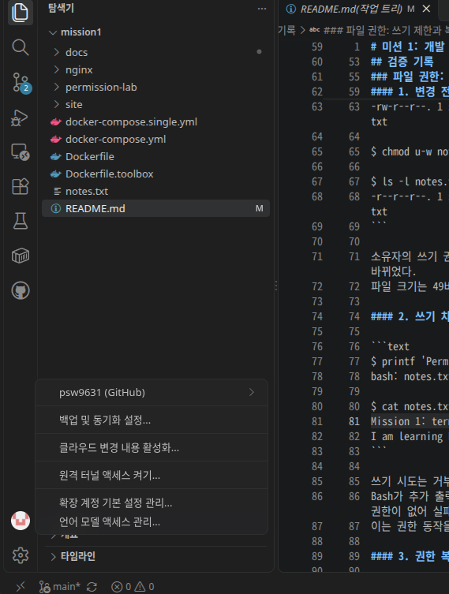

# 미션 1: 개발 워크스테이션 구축

## 프로젝트 개요

Fedora KDE 환경에서 터미널, 파일 권한, Docker, Git/GitHub를 학습한다.
필수 과제와 보너스 과제를 직접 수행하고, 명령과 실제 출력으로 결과를 검증한다.
다른 사람이 재현할 수 있도록 실행 절차와 증거를 기록한다.

## 실행 환경

- OS: Fedora Linux 45 (KDE Plasma Desktop Edition)
- Shell: Bash
- 작업 경로: ~/Projects/mission1
- Docker 버전: 29.9.3
- Git 버전: 2.56.0
- 터미널 프로그램: Konsole

작업 경로의 `~`는 각 사용자의 홈 디렉터리를 뜻한다.

## 수행 체크리스트

### 필수 과제

- [x] 현재 위치·숨김 파일 확인, 절대·상대 경로 이해
- [x] 디렉터리 생성·이동·삭제
- [x] 파일 생성·읽기·쓰기·복사·이름 변경·이동·삭제
- [x] 파일 권한 변경 전후 및 쓰기 차단 검증
- [x] 디렉터리 권한 변경 전후 및 접근 차단 검증
- [x] 터미널·권한 실습의 명령과 실제 출력 기록
- [x] Git 사용자 정보·기본 브랜치 설정 및 설정 결과 기록
- [x] Docker 설치·버전·데몬 동작 확인
- [x] 이미지 다운로드·목록 및 컨테이너 실행·중지·목록 확인
- [x] 컨테이너 로그·리소스 사용량 확인
- [x] hello-world 실행
- [x] Ubuntu 컨테이너 내부 명령 및 attach/exec 차이 관찰
- [x] 웹 소스와 Dockerfile 직접 작성, 커스텀 이미지 빌드·실행
- [x] 포트 매핑 및 브라우저 접속 증거 기록
- [x] 바인드 마운트 변경 전후 비교
- [x] 볼륨 데이터의 컨테이너 삭제 전후 영속성 검증
- [x] VSCode GitHub 로그인·저장소 연동
- [x] 트러블슈팅 2건 이상 기록
- [x] README의 검증 절차·증거 링크·재현성·민감정보 점검
- [x] GitHub 저장소 링크로 최종 결과 제출

### 보너스 과제

- [x] Compose 단일 서비스 실행
- [x] Compose 멀티 컨테이너 실행 및 서비스 간 통신 검증
- [x] Compose up/down/ps/logs 사용
- [x] 환경 변수로 서버 포트 또는 모드 변경 및 검증
- [x] GitHub SSH 키 설정 및 SSH로 푸시

## 검증 기록

### 파일 권한: 쓰기 제한과 복구

목적: 소유자의 쓰기 권한을 제거하면 파일에 내용을 추가할 수 없는지 확인한다.

#### 1. 변경 전후 권한 확인

```text
$ ls -l notes.txt
-rw-r--r--. 1 suwan suwan 49 11월  5일  13:12 notes.txt

$ chmod u-w notes.txt

$ ls -l notes.txt
-r--r--r--. 1 suwan suwan 49 11월  5일  13:12 notes.txt
```

소유자의 쓰기 권한을 제거하여 권한이 644에서 444로 바뀌었다.
파일 크기는 49바이트로 유지됐다.

#### 2. 쓰기 차단과 내용 유지 확인

```text
$ printf 'Permission test\n' >> notes.txt
bash: notes.txt: 허가 거부

$ cat notes.txt
Mission 1: terminal practice
I am learning Bash.
```

쓰기 시도는 거부됐고, 기존 두 줄만 남았다.
Bash가 추가 출력을 위해 파일을 열려고 했지만 쓰기 권한이 없어 실패했다.
이는 권한 동작을 확인하기 위해 의도적으로 만든 오류다.

#### 3. 권한 복구

```text
$ chmod u+w notes.txt

$ ls -l notes.txt
-rw-r--r--. 1 suwan suwan 49 11월  5일  13:12 notes.txt
```

소유자의 쓰기 권한을 복구하여 다시 644가 됐다.

검증 결과: 일반 사용자 suwan으로 실행했을 때 파일 쓰기 권한에 따라
내용 추가가 차단됐으며, 실험 후 원래 권한으로 복구했다.

재현 조건: 자신이 소유하고 쓰기 가능한 디렉터리에서,
두 줄의 내용이 있는 notes.txt를 준비하고 일반 사용자로 수행한다.
사용자명, 날짜, 파일 크기는 준비한 환경과 내용에 따라 달라질 수 있다.

### 디렉터리 권한: 목록 조회와 내부 파일 접근의 차이

목적: 디렉터리의 r과 x 권한이 어떻게 다른지 확인한다.

#### 1. 실험 준비와 초기 상태

```text
$ mkdir permission-lab
$ printf 'Directory permission test\n' > permission-lab/sample.txt
$ chmod 755 permission-lab
$ ls -ld permission-lab
drwxr-xr-x. 1 suwan suwan 20 11월  5일  13:25 permission-lab

$ cat permission-lab/sample.txt
Directory permission test
```

초기 권한은 755이며, 소유자는 목록 조회와 내부 파일 접근이 가능했다.

#### 2. 소유자의 x 제거 후 비교

```text
$ chmod u-x permission-lab
$ ls -ld permission-lab
drw-r-xr-x. 1 suwan suwan 20 11월  5일  13:25 permission-lab

$ ls permission-lab
ls: 'permission-lab/sample.txt'에 접근할 수 없음: 허가 거부
sample.txt

$ cat permission-lab/sample.txt
cat: permission-lab/sample.txt: 허가 거부
```

권한이 755에서 655로 바뀌었다.
r이 남아 있어 sample.txt라는 이름은 보였지만,
x가 없어 파일에 접근하거나 내용을 읽을 수 없었다.
ls도 표시를 위한 추가 정보 조회 과정에서 접근 오류를 출력했다.

소유자에게는 소유자 권한이 적용되므로,
그룹이나 기타 사용자에게 남아 있는 x를 대신 적용받지 않는다.

#### 3. 권한 복구와 접근 재검증

```text
$ chmod u+x permission-lab
$ ls -ld permission-lab
drwxr-xr-x. 1 suwan suwan 20 11월  5일  13:25 permission-lab

$ cat permission-lab/sample.txt
Directory permission test
```

검증 결과: 디렉터리의 x를 복구하자 내부 파일을 다시 읽을 수 있었다.
파일 내용을 읽으려면 경로상 디렉터리의 x와 대상 파일의 r이 필요하다.

재현 조건: 자신이 소유한 실험용 디렉터리에서 일반 사용자로 수행한다.
상위 경로에 접근할 수 있고 sample.txt에 읽기 권한이 있어야 한다.
사용자명, 날짜, 디렉터리 크기 및 ls의 표시 방식은 환경에 따라 다를 수 있다.

### 터미널 기본 조작: 복사·이름 변경·이동·삭제

아래는 실습 당시 수행한 명령과 실제 출력이다.
cp는 실행 후 확인한 결과로 복사 성공을 검증했다.
출력이 없는 명령은 명령만 기록했다.

#### 1. 파일 복사 및 내용 확인

```text
$ cp notes.txt notes-copy.txt
$ ls -l notes.txt notes-copy.txt
-rw-r--r--. 1 suwan suwan 49 11월  5일  13:13 notes-copy.txt
-rw-r--r--. 1 suwan suwan 49 11월  5일  13:12 notes.txt

$ cat notes-copy.txt
Mission 1: terminal practice
I am learning Bash.
```

복사 후 원본과 복사본이 모두 존재하고, 크기와 내용을 확인했다.

#### 2. 이름 변경

```text
$ mv notes-copy.txt notes-backup.txt
$ ls -l notes.txt notes-backup.txt
-rw-r--r--. 1 suwan suwan 49 11월  5일  13:13 notes-backup.txt
-rw-r--r--. 1 suwan suwan 49 11월  5일  13:12 notes.txt

$ ls -l notes-copy.txt
ls: 'notes-copy.txt'에 접근할 수 없음: 그런 파일이나 디렉터리가 없습니다
```

같은 디렉터리 안에서 mv로 이름을 변경했다.
이전 이름을 찾을 수 없다는 오류는 예상된 검증 결과다.

#### 3. 하위 디렉터리로 이동

```text
$ mkdir backups
$ mv notes-backup.txt backups/
$ ls -l backups/notes-backup.txt
-rw-r--r--. 1 suwan suwan 49 11월  5일  13:13 backups/notes-backup.txt

$ ls -l notes-backup.txt
ls: 'notes-backup.txt'에 접근할 수 없음: 그런 파일이나 디렉터리가 없습니다
```

파일이 대상 디렉터리 안에 존재하고 기존 위치에서는 사라진 것을 확인했다.

#### 4. 파일과 빈 디렉터리 삭제

```text
$ rm backups/notes-backup.txt
$ ls -l backups/notes-backup.txt
ls: 'backups/notes-backup.txt'에 접근할 수 없음: 그런 파일이나 디렉터리가 없습니다

$ rmdir backups
$ ls -la
합계 4
drwxr-xr-x. 1 suwan suwan 18 11월  5일  13:20 .
drwxr-xr-x. 1 suwan suwan 16 11월  5일  13:06 ..
-rw-r--r--. 1 suwan suwan 49 11월  5일  13:12 notes.txt
```

復사본과 빈 디렉터리는 삭제됐고 원본 notes.txt는 유지됐다.
rmdir는 비어 있지 않은 디렉터리의 삭제를 거부한다.

재현 시에는 두 줄의 내용이 있는 notes.txt를 준비하고,
같은 이름의 복사본이나 backups 디렉터리가 없는 연습 환경에서 수행한다.

### 터미널 기본 조작: 경로 이동과 빈 파일 생성

아래는 README 작성 전 실습 당시의 명령과 실제 출력이다.

#### 1. 상대 경로로 이동하고 절대 경로 확인

홈 디렉터리에서 다음 명령을 수행했다.

```text
$ cd Projects/mission1
$ pwd
/home/suwan/Projects/mission1
```

Projects/mission1은 현재 위치를 기준으로 해석하는 상대 경로다.
pwd는 이동 후 현재 위치를 절대 경로로 출력했다.
디렉터리를 만드는 mkdir와 현재 위치를 바꾸는 cd는 별개다.
이 위치에서 ..은 부모 디렉터리인 /home/suwan/Projects를 뜻한다.

#### 2. 빈 파일 생성과 검증

```text
$ touch notes.txt
$ ls -l notes.txt
-rw-r--r--. 1 suwan suwan 0 11월  5일  13:09 notes.txt

$ cat notes.txt
```

파일 크기 0바이트와 cat의 출력 없음을 통해 빈 파일임을 확인했다.
touch는 파일이 없으면 생성하고, 이미 있으면 내용을 비우지 않고
시간 정보를 갱신한다.

#### 3. 내용 쓰기와 추가 후 확인

```text
$ printf 'Mission 1: terminal practice\n' > notes.txt
$ cat notes.txt
Mission 1: terminal practice
```

이후 다음 명령으로 두 번째 줄을 추가했다.

```bash
printf 'I am learning Bash.\n' >> notes.txt
```

추가 후 확인한 실제 출력:

```text
$ cat notes.txt
Mission 1: terminal practice
I am learning Bash.
```

>는 기존 내용을 덮어쓰고, >>는 파일 끝에 추가한다.
출력 방향을 바꾸는 기호는 Bash가 해석한다.

재현 조건: 홈 디렉터리 아래 Projects/mission1을 준비한다.
빈 파일 생성부터 재현하려면 notes.txt가 없는 별도의 연습 환경을 사용한다.
현재 결과물을 비우거나 덮어쓰지 않도록 주의한다.

### 터미널·권한 실습 후 상태 확인

다음은 파일 조작과 권한 실습을 마치고 README를 작성하던 시점의 실제 출력이다.
README 크기는 이후 내용을 추가하면서 달라진다.

```text
$ pwd
/home/suwan/Projects/mission1

$ ls -la
합계 12
drwxr-xr-x. 1 suwan suwan   64 11월  5일  13:34 .
drwxr-xr-x. 1 suwan suwan   16 11월  5일  13:06 ..
-rw-r--r--. 1 suwan suwan 5822 11월  5일  13:45 README.md
-rw-r--r--. 1 suwan suwan   49 11월  5일  13:12 notes.txt
drwxr-xr-x. 1 suwan suwan   20 11월  5일  13:25 permission-lab

$ cat notes.txt
Mission 1: terminal practice
I am learning Bash.

$ ls -ld permission-lab
drwxr-xr-x. 1 suwan suwan 20 11월  5일  13:25 permission-lab
```

ls -la는 상세 정보와 숨김 항목을 포함해 목록을 표시한다.
.은 현재 디렉터리이고, ..은 부모 디렉터리다.
이름이 .으로 시작하는 항목은 기본 ls에서는 숨겨진다.

검증 결과: 현재 위치, 원본 내용 유지, 디렉터리 권한 755 복구를 확인했다.

### Git 첫 커밋 생성과 검증

세 파일을 스테이징한 뒤 첫 커밋을 만들었다.

```text
$ git add README.md notes.txt permission-lab/sample.txt

$ git commit -m "docs: 터미널 및 권한 실습 기록"
[main (최상위-커밋) c76fd55] docs: 터미널 및 권한 실습 기록
 3 files changed, 332 insertions(+)
 create mode 100644 README.md
 create mode 100644 notes.txt
 create mode 100644 permission-lab/sample.txt

$ git log -1 --oneline
c76fd55 (HEAD -> main) docs: 터미널 및 권한 실습 기록

$ git status
현재 브랜치 main
커밋할 사항 없음, 작업 폴더 깨끗함
```

검증 결과: 첫 커밋에 세 파일이 기록됐고, 직후 미반영 변경은 없었다.
이 커밋은 로컬에 저장됐으며 아직 GitHub에 업로드하지 않았다.
커밋 식별자는 재현 시 달라질 수 있다.

### Docker 리소스 조회와 중지 결과

실행 중인 Ubuntu 컨테이너의 리소스를 조회하고 중지했다.

```text
$ docker stats --no-stream mission1-ubuntu
CONTAINER ID   NAME              CPU %     MEM USAGE / LIMIT   MEM %     NET I/O         BLOCK I/O   PIDS
6bdc3cf5f893   mission1-ubuntu   0.00%     948KiB / 12.7GiB    0.01%     79.8kB / 126B   0B / 0B     1

$ docker stop mission1-ubuntu
mission1-ubuntu

$ docker ps -a --filter name=mission1-ubuntu
CONTAINER ID   IMAGE          COMMAND   CREATED          STATUS                       PORTS     NAMES
6bdc3cf5f893   ubuntu:24.04   "bash"    10 minutes ago   Exited (137) 7 seconds ago             mission1-ubuntu

$ docker inspect --format 'ExitCode={{.State.ExitCode}} OOMKilled={{.State.OOMKilled}} Error={{.State.Error}}' mission1-ubuntu
ExitCode=137 OOMKilled=false Error=
```

#### 트러블슈팅: 중지 후 종료 코드 137

- 문제: docker stop 후 예상했던 정상 종료 코드 0 대신 137이 표시됐다.
- 원인 가설: 주 Bash가 종료 신호에 반응하지 않아 대기 후 강제 종료됐을 가능성, 또는 메모리 부족 가능성을 생각했다.
- 확인: inspect 결과 ExitCode=137, OOMKilled=false, Error는 비어 있었다.
- 해석: 종료 코드는 SIGKILL과 일치하지만, Docker에 메모리 부족 종료 기록은 없었다. stop의 대기 시간 초과 가능성은 있으며, 신호의 전체 과정은 현재 증거만으로 확정하지 않았다.
- 처리 및 대안: 컨테이너가 중지된 것을 확인했다. 앞선 실습에서는 주 Bash에서 exit를 실행했을 때 Exited (0)으로 종료되는 것을 관찰했다.

리소스 수치와 경과 시간은 측정 시점 및 환경에 따라 달라진다.

### hello-world 실행 검증과 이름 충돌 해결

사용한 이미지: hello-world:latest
컨테이너 이름: mission1-hello

아래 긴 오류 메시지와 안내 로그는 핵심 부분을 발췌했다.

#### 1. 새 컨테이너 생성 시 이름 충돌

```text
$ docker run --name mission1-hello hello-world:latest
docker: Error response from daemon: Conflict. The container name "/mission1-hello" is already in use by container "6ded44e76eb33297882cac70638fe8544c5ee300be7b21132be85f797defd4ff". You have to remove (or rename) that container to be able to reuse that name.
```

#### 2. 기존 컨테이너 상태와 로그 확인

```text
$ docker ps -a --filter name=mission1-hello
CONTAINER ID   IMAGE                COMMAND    CREATED         STATUS                     PORTS     NAMES
6ded44e76eb3   hello-world:latest   "/hello"   2 minutes ago   Exited (0) 2 minutes ago             mission1-hello

$ docker logs mission1-hello

Hello from Docker!
This message shows that your installation appears to be working correctly.
```

기존 컨테이너는 이미 안내 문구를 출력하고 정상 종료한 상태였다.
종료된 컨테이너도 삭제 전까지 이름을 차지한다.
기존 컨테이너가 처음 생성된 경위는 이 기록만으로 확정하지 않았다.

#### 3. 기존 컨테이너 재실행

```text
$ docker start -a mission1-hello

Hello from Docker!
This message shows that your installation appears to be working correctly.

$ docker ps -a --filter name=mission1-hello
CONTAINER ID   IMAGE                COMMAND    CREATED         STATUS                     PORTS     NAMES
6ded44e76eb3   hello-world:latest   "/hello"   3 minutes ago   Exited (0) 5 seconds ago             mission1-hello
```

같은 컨테이너 ID로 안내 문구가 다시 출력되고 정상 종료됐다.
따라서 새 컨테이너 생성이 아니라 기존 컨테이너의 재실행임을 확인했다.

#### 트러블슈팅: 컨테이너 이름 충돌

- 문제: docker run으로 mission1-hello를 생성하려 했지만 이름 충돌로 실패했다.
- 원인 가설: 같은 이름의 컨테이너가 이미 존재할 것으로 생각했다.
- 확인: docker ps -a에서 해당 이름의 종료된 컨테이너를 확인했고, logs로 실행 결과를 조회했다.
- 해결: 기존 컨테이너를 유지하고 docker start -a로 다시 실행했다.
- 검증: 컨테이너 ID가 유지됐고 Hello from Docker! 출력과 Exited (0)을 확인했다.

명령의 차이:
- docker run: 이미지로 새 컨테이너를 생성하고 실행한다.
- docker start: 기존 컨테이너를 다시 실행한다.
- docker logs: 컨테이너의 출력 기록을 조회한다.

재현 시 hello-world:latest 이미지를 준비하고 해당 이름이 비어 있는 상태에서
docker run --name mission1-hello hello-world:latest를 실행한다.
종료 후 같은 run 명령을 반복하면 이름 충돌을 관찰할 수 있다.
이후 위 상태 조회, 로그 확인, start 명령으로 검증한다.
컨테이너 ID와 경과 시간은 재현 시 달라진다.

### Ubuntu 컨테이너 내부 명령과 exec·attach 비교

이미지: ubuntu:24.04
컨테이너: mission1-ubuntu

아래 OS 정보와 상태 출력은 핵심 항목을 발췌했다.

#### 1. 컨테이너 생성과 내부 명령

```text
$ docker run -it --name mission1-ubuntu ubuntu:24.04 bash
root@6bdc3cf5f893:/# pwd
/
root@6bdc3cf5f893:/# cat /etc/os-release
PRETTY_NAME="Ubuntu 24.04.5 LTS"
NAME="Ubuntu"
VERSION_ID="24.04"
root@6bdc3cf5f893:/# echo 'Hello from inside the container'
Hello from inside the container
```

Fedora 호스트와 다른 Ubuntu 사용자 공간에서 명령을 실행했다.
컨테이너 내부의 /는 컨테이너 파일 시스템의 최상위 경로다.
호스트 OS를 교체한 것은 아니며, Linux 커널은 호스트와 공유한다.

주 Bash에서 exit로 나온 뒤 확인한 상태:

```text
$ docker ps
CONTAINER ID   IMAGE     COMMAND   CREATED   STATUS    PORTS     NAMES

$ docker ps -a --filter name=mission1-ubuntu
CONTAINER ID   IMAGE          COMMAND   CREATED              STATUS                      PORTS     NAMES
6bdc3cf5f893   ubuntu:24.04   "bash"    About a minute ago   Exited (0) 19 seconds ago             mission1-ubuntu
```

주 프로그램인 Bash가 종료되자 컨테이너도 정상 종료했다.
컨테이너 자체는 삭제되지 않았다.

#### 2. exec: 별도의 Bash 실행

```text
$ docker start mission1-ubuntu
mission1-ubuntu

$ docker ps --filter name=mission1-ubuntu
CONTAINER ID   IMAGE          COMMAND   CREATED         STATUS         PORTS     NAMES
6bdc3cf5f893   ubuntu:24.04   "bash"    2 minutes ago   Up 9 seconds             mission1-ubuntu

$ docker exec -it mission1-ubuntu bash
root@6bdc3cf5f893:/# echo 'This is the exec shell'
This is the exec shell
root@6bdc3cf5f893:/# exit
exit

$ docker ps --filter name=mission1-ubuntu
CONTAINER ID   IMAGE          COMMAND   CREATED         STATUS          PORTS     NAMES
6bdc3cf5f893   ubuntu:24.04   "bash"    3 minutes ago   Up 49 seconds             mission1-ubuntu
```

echo와 exit의表示順序는 읽기 쉽게 정리했다.
exec는 실행 중인 컨테이너 안에서 추가 프로세스를 실행한다.
추가 Bash를 종료해도 주 Bash가 살아 있어 컨테이너는 유지됐다.

#### 3. attach: 주 Bash에 연결 후 연결만 해제

```text
$ docker attach mission1-ubuntu
root@6bdc3cf5f893:/# echo 'This is the main shell'
This is the main shell
root@6bdc3cf5f893:/# read escape sequence
```

Ctrl+P를 누른 뒤 Ctrl+Q를 눌러 연결만 해제했다.

```text
$ docker ps --filter name=mission1-ubuntu
CONTAINER ID   IMAGE          COMMAND   CREATED         STATUS         PORTS     NAMES
6bdc3cf5f893   ubuntu:24.04   "bash"    5 minutes ago   Up 2 minutes             mission1-ubuntu
```

attach는 새 Bash를 만들지 않고 기존 주 프로그램의 입출력에 연결한다.
연결 해제 후에도 컨테이너가 실행 중임을 확인했다.

| 조작 | 관찰 결과 |
|---|---|
| 주 Bash에서 exit | 컨테이너 종료 |
| exec로 추가한 Bash에서 exit | 추가 Bash만 종료, 컨테이너 유지 |
| attach 후 Ctrl+P, Ctrl+Q | 연결만 해제, 컨테이너 유지 |

재현 시 같은 이름의 컨테이너가 없는 환경에서 시작한다.
이번 start 후 유지 동작은 최초 생성 시 -it로 만든 Bash 컨테이너에서 관찰했다.
컨테이너 ID, OS 패치 버전, 경과 시간은 달라질 수 있다.

### Docker 버전과 데몬 연결 확인

Docker는 기존에 설치돼 있었으며, 이번 실습에서는 설치 상태와 동작을 확인했다.
docker info 출력은 핵심 항목만 발췌했다.

```text
$ docker --version
Docker version 29.9.3, build 5457199

$ docker info
Client: Docker Engine - Community
 Version:    29.9.3
 Context:    default
 Debug Mode: false
 Plugins:
  buildx: Docker Buildx (Docker Inc.)
    Version:  v0.38.1
  compose: Docker Compose (Docker Inc.)
    Version:  v5.7.0

Server:
 Containers: 0
  Running: 0
  Paused: 0
  Stopped: 0
 Images: 1
 Server Version: 29.9.3
 Storage Driver: overlayfs
 Cgroup Driver: systemd
 Cgroup Version: 2
 Operating System: Fedora Linux 45 (KDE Plasma Desktop Edition)
 OSType: linux
 Architecture: x86_64
```

검증 결과:
- Docker CLI와 서버 버전은 모두 29.9.3이었다.
- sudo 없이 Server 정보를 조회하여 데몬 연결과 현재 사용자의 접근 가능 여부를 확인했다.
- 점검 당시 컨테이너는 0개, 이미지는 1개였다.
- Compose 플러그인도 설치돼 있었다.

docker --version만으로 데몬 동작까지 확인할 수는 없다.
docker info에서 서버 정보를 조회하는 별도 검증을 수행했다.

### 이미지 다운로드와 목록 확인

실습 시작 시 hello-world:latest 이미지가 로컬에 존재했다.
이후 Ubuntu 실습을 위해 ubuntu:24.04 이미지를 다운로드했다.

```text
$ docker pull ubuntu:24.04
24.04: Pulling from library/ubuntu
7a48b8f0e5c7: Pull complete
98144013299c: Download complete
Digest: sha256:fe81560990fae86dc4743202b2cb4d3df98d0bcf949173cecef15ce1127ef852
Status: Downloaded newer image for ubuntu:24.04
docker.io/library/ubuntu:24.04

$ docker images ubuntu:24.04
IMAGE          ID             DISK USAGE   CONTENT SIZE   EXTRA
ubuntu:24.04   fe81560990fa   117MB        31.7MB
```

이미지 목록 출력에서는 안내 문구와 장식 표시를 생략했다.

검증 결과: 다운로드 성공 메시지와 로컬 이미지 목록을 함께 확인했다.
이후 이 이미지로 mission1-ubuntu 컨테이너를 생성해 내부 명령을 실행했다.

- 이미지: 실행에 필요한 프로그램·파일·기본 설정을 담은 것
- 컨테이너: 이미지를 바탕으로 생성한 실행 단위
- pull: 이미지를 받는 작업이며, 컨테이너를 생성하거나 실행하지 않는다.

재현 시 다운로드 결과는 로컬 캐시와 레지스트리 상태에 따라 달라질 수 있다.
태그가 가리키는 이미지, 식별자, 크기와 출력 형식도 달라질 수 있다.

### Git 사용자 정보와 기본 브랜치 설정

현재 사용자의 전역 설정을 조회했다.
아래는 확인한 항목의 발췌이며 이메일은 마스킹했다.

```text
$ git config --global --list
user.name=psw9631
user.email=<이메일 가림>
init.defaultbranch=main
```

user.name과 user.email은 커밋 작성자 정보이며 GitHub 로그인 설정이 아니다.
init.defaultBranch는 새 저장소를 초기화할 때 사용할 기본 브랜치 이름이다.
기존 사용자 정보는 유지하고, 기본 브랜치는 다음 명령으로 설정했다.

```text
$ git config --global init.defaultBranch main
$ git config --global --get init.defaultBranch
main
```

검증 결과: 작성자 정보와 기본 브랜치 설정을 확인했다.
이후 git init으로 만든 저장소의 브랜치가 main인 것도 확인했다.

재현 시 user.name과 user.email은 본인의 정보를 사용한다.
전역 설정은 현재 사용자에게 적용되며 저장소별 설정으로 덮어쓸 수 있다.

### 바인드 마운트: 호스트 변경의 즉시 반영

목적: 이미지에 COPY한 파일과 바인드 마운트로 연결한 파일의 차이를 확인한다.

#### 1. COPY된 파일은 호스트 수정만으로 바뀌지 않음

호스트 파일을 v1에서 v2로 수정한 뒤 비교했다.

```text
$ sed -i 's/페이지 버전: v1/페이지 버전: v2/' site/index.html

$ cat site/index.html
  <p>페이지 버전: v2</p>

$ curl -sS http://127.0.0.1:8080
  <p>페이지 버전: v1</p>
```

cat과 curl의 HTML 출력은 버전 줄만 발췌했다.
기존 컨테이너는 빌드 시 이미지에 복사한 v1을 계속 제공했다.

#### 2. 바인드 마운트 컨테이너 실행

```bash
docker run -d \
  --name mission1-web-bind \
  -p 127.0.0.1:8081:80 \
  -v "$PWD/site:/usr/share/nginx/html:ro,Z" \
  mission1-web:1.0
```

실행 결과:

```text
e64306b1fc24581fab2ab47dde36ccaafd9bc3f20a74809c92a1299b1e820c43
```

연결 후 응답에서 확인한 버전 줄:

```text
$ curl -sS http://127.0.0.1:8081
  <p>페이지 버전: v2</p>
```

ro는 컨테이너에서 읽기 전용으로 연결하는 옵션이다.
Z는 해당 호스트 폴더의 SELinux 라벨을 이 컨테이너용으로 조정한다.
이번 실습에서는 프로젝트의 site 폴더에만 적용했다.

#### 3. 재빌드·재시작 없이 변경 반영

아래 cat과 curl 출력은 버전 줄만 발췌했다.

```text
$ sed -i 's/페이지 버전: v2/페이지 버전: v3/' site/index.html

$ cat site/index.html
  <p>페이지 버전: v3</p>

$ curl -sS http://127.0.0.1:8081
  <p>페이지 버전: v3</p>

$ curl -sS http://127.0.0.1:8080
  <p>페이지 버전: v1</p>
```

호스트 파일과 바인드 마운트側은 v3으로 바뀌었지만,
기존 컨테이너는 v1을 유지했다.
이미지를 다시 빌드하거나 컨테이너를 재시작하지 않았다.

#### 4. 실제 연결 설정 검증

```text
$ docker inspect --format '{{range .Mounts}}Type={{.Type}} Source={{.Source}} Destination={{.Destination}} RW={{.RW}}{{println}}{{end}}' mission1-web-bind
Type=bind Source=/home/suwan/Projects/mission1/site Destination=/usr/share/nginx/html RW=false
```

검증 결과: 호스트의 site 디렉터리가 컨테이너 웹 경로에
읽기 전용 바인드 마운트로 연결된 것을 확인했다.
호스트에서는 파일을 수정할 수 있으며, 컨테이너는 변경된 파일을 읽는다.
연결 경로에서는 이미지에 있던 파일 대신 호스트 파일이 보인다.
이미지 자체가 변경되는 것은 아니다.

재현 시 프로젝트 루트에서 실행하고, 비교용 v1 이미지를 먼저 빌드한다.
컨테이너 이름과 호스트 포트가 사용 중이지 않은지 확인한다.
Source 경로와 컨테이너 ID는 실행 환경에 따라 달라진다.

### 웹 서버 브라우저 접속 증거

브라우저에서 http://127.0.0.1:8080 에 접속했다.
주소창의 호스트 포트 8080과 페이지 버전 v1을 함께 확인했다.



이 컨테이너는 mission1-web:1.0 이미지에 복사된 HTML을 제공한다.
호스트의 8080 포트는 컨테이너의 80 포트에 연결돼 있다.

### 커스텀 웹 이미지 빌드

베이스 이미지: nginx:stable-alpine

- LABEL: 이미지에 프로젝트 제목을 기록한다.
- COPY: 직접 작성한 웹 파일을 NGINX 웹 경로에 복사한다.

빌드 명령: `docker build --progress=plain -t mission1-web:1.1 .`

검증: 종료 코드 0과 이미지 생성 완료 로그를 확인했다.

[전체 빌드 로그](docs/logs/build-web-1.1.log)

[Dockerfile](Dockerfile) / [웹 소스](site/index.html)

1.0 이미지는 페이지 v1을 포함한다. 새로 빌드한 1.1 이미지는 페이지 v3을 포함하며, 아직 실행 검증 전이다.

### 커스텀 이미지 1.1 실행 검증

mission1-web:1.1 이미지로 mission1-web-1-1 컨테이너를 실행했다.
호스트 8082 포트를 컨테이너 80 포트에 연결했다.
바인드 마운트 없이 HTTP 200 OK와 페이지 v3 응답을 확인했다.
앞선 빌드 항목에서 실행 검증 전이라고 기록한 상태를 이번 실험으로 검증 완료했다.

[실행 명령·컨테이너 ID·HTTP 응답](docs/logs/run-web-1.1.log)

로그 저장 참고: run-web-1.1.log는 curl 응답을 수집한 뒤 문서용으로 줄 끝의 CR을 제거해 LF 형식으로 정리했다.

### Docker 볼륨 영속성 검증

목적: 컨테이너를 삭제한 뒤 새 컨테이너에 같은 볼륨을 연결하여 데이터가 유지되는지 확인한다.

#### 1. 볼륨 생성과 확인

```text
$ docker volume create mission1-data
mission1-data

$ docker volume inspect --format 'Name={{.Name}} Driver={{.Driver}}' mission1-data
Name=mission1-data Driver=local
```

#### 2. 컨테이너 A에서 데이터 기록

```text
$ docker run -d --name mission1-volume-a --mount type=volume,source=mission1-data,target=/data ubuntu:24.04 sleep infinity
97cc17d80ea39475974ed20d220c8b4a23a603c21321eef41d341719190eb1ff

$ docker exec mission1-volume-a sh -c 'printf "Written by container A\n" > /data/mission1-proof.txt'

$ docker exec mission1-volume-a cat /data/mission1-proof.txt
Written by container A
```

볼륨을 컨테이너의 /data에 연결하고 그 안에 파일을 기록했다.

#### 3. 컨테이너 A 삭제 확인

```text
$ docker stop mission1-volume-a
mission1-volume-a

$ docker rm mission1-volume-a
mission1-volume-a

$ docker ps -a --filter name=mission1-volume-a
CONTAINER ID   IMAGE     COMMAND   CREATED   STATUS    PORTS     NAMES
```

컨테이너 A는 삭제했지만 볼륨은 삭제하지 않았다.

#### 4. 새 컨테이너 B에서 기존 데이터 확인

```text
$ docker run -d --name mission1-volume-b --mount type=volume,source=mission1-data,target=/data ubuntu:24.04 sleep infinity
81b15e7b7edfe199e4a6cee22864f682b6d73155b67b416d2a928d59dd905a5b

$ docker exec mission1-volume-b cat /data/mission1-proof.txt
Written by container A

$ docker inspect --format '{{range .Mounts}}Type={{.Type}} Name={{.Name}} Destination={{.Destination}}{{println}}{{end}}' mission1-volume-b
Type=volume Name=mission1-data Destination=/data
```

검증 결과:
- A와 B의 컨테이너 ID가 다르므로 서로 다른 컨테이너다.
- B에서 파일을 새로 쓰지 않고 A가 기록한 내용을 읽었다.
- B에 같은 mission1-data 볼륨이 연결된 것을 확인했다.
- 따라서 볼륨 데이터는 컨테이너 A의 삭제 후에도 유지됐다.

재현 시 컨테이너 이름이 사용 중이지 않은 환경에서 수행한다.
컨테이너 ID는 실행마다 달라진다.
데이터는 볼륨이 연결된 /data 아래에 기록해야 한다.
볼륨 자체를 삭제하면 데이터도 잃을 수 있으므로 이 실험에서는 유지한다.

### Compose 단일 서비스와 운영 명령

docker-compose.yml에 이미지와 포트 연결을 선언했다.
긴 실행 명령을 파일로 보관하여 같은 설정으로 다시 실행할 수 있다.

[Compose 단일 서비스 설정 파일](docker-compose.single.yml)

#### 실행과 접속 검증

아래 출력은 핵심 항목만 발췌했다.

```text
$ docker compose -f docker-compose.yml config
name: mission1
```

설정 해석에 성공했고, web 서비스의 이미지와 포트 설정을 확인했다.

```text
$ docker compose -f docker-compose.yml up -d
Network mission1_default Created
Container mission1-web-1 Started

$ docker compose -f docker-compose.yml ps
```

ps 결과에서 서비스 web, 이미지 mission1-web:1.1,
실행 상태 Up, 포트 127.0.0.1:8083->80/tcp를 확인했다.

```text
$ curl -i http://127.0.0.1:8083
HTTP/1.1 200 OK
```

응답 본문에서 페이지 버전 v3을 확인했다.

#### 로그 조회

최근 로그 10줄을 조회했으며, 아래는 요청 기록의 발췌다.

```text
$ docker compose -f docker-compose.yml logs --tail 10 web
web-1  | 172.18.0.1 - - [05/Nov/2026:06:56:11 +0000] "GET / HTTP/1.1" 200 357 "-" "curl/8.21.0" "-"
```

페이지 요청은 200으로 성공했다.
별도 favicon.ico 요청은 파일이 없어 404를 반환했다.
요청 경로별로 결과를 구분해야 하며, 이 404는 페이지 요청 실패를 뜻하지 않는다.

#### 종료와 제거 확인

아래 down 출력은 진행 표시와 소요 시간을 생략했다.

```text
$ docker compose -f docker-compose.yml down
Container mission1-web-1 Removed
Network mission1_default Removed

$ docker compose -f docker-compose.yml ps -a
NAME      IMAGE     COMMAND   SERVICE   CREATED   STATUS    PORTS
```

검증 결과: up으로 실행하고 ps와 HTTP 응답으로 상태를 확인했다.
logs로 요청 기록을 조회했으며, down 후 서비스 컨테이너와
기본 네트워크가 제거된 것을 확인했다.

재현 조건: 로컬에 mission1-web:1.1 이미지를 먼저 빌드하고
호스트 8083 포트가 비어 있는 상태에서 프로젝트 루트에서 실행한다.
컨테이너 이름, 네트워크 이름, 시각과 로그 세부 내용은 달라질 수 있다.

### Compose 멀티 컨테이너 통신 검증

웹 서버 web과 보조 서비스 toolbox를 같은 Compose 기본 네트워크에서 실행했다.

구성 파일:
- [단일 서비스 설정](docker-compose.single.yml)
- [멀티 서비스 설정](docker-compose.yml)
- [보조 서비스 Dockerfile](Dockerfile.toolbox)

보조 서비스는 Ubuntu 기반 이미지에 curl을 설치하여 빌드했다.
따라서 컨테이너를 새로 생성해도 수동 설치 없이 HTTP 요청을 보낼 수 있다.

빌드 및 실행 명령: `docker compose -f docker-compose.yml up -d --build`

검증 결과:
- web은 mission1-web:1.1, toolbox는 mission1-toolbox:1.0 이미지로 실행됐다.
- toolbox에서 getent hosts web으로 웹 서비스의 주소를 조회했다.
- toolbox에서 http://web:80으로 요청하여 HTTP 200 OK와 페이지 v3을 확인했다.
- 호스트의 8083 포트를 거치지 않고 컨테이너 네트워크로 통신했다.

[서비스 상태·이름 조회·HTTP 응답 로그](docs/logs/compose-multi.log)

서비스 이름 web은 통신에 사용하지만, 컨테이너 IP는 재생성 시 달라질 수 있다.
컨테이너 안의 localhost는 해당 컨테이너 자신을 가리킨다.

로그의 HTTP 줄바꿈은 수집 후 문서용 LF 형식으로 정리했다.

재현 순서:
1. 프로젝트 루트에서 mission1-web:1.1 이미지를 먼저 빌드한다.
2. 호스트 8083 포트가 비어 있는지 확인한다.
3. 위 Compose 빌드 및 실행 명령을 수행한다.
4. 로그에 기록된 ps, getent, curl 명령으로 검증한다.

단일 서비스 실습만 재현할 때는 docker-compose.single.yml을 사용한다.
두 구성은 같은 프로젝트 이름을 사용하므로 한 구성을 down한 뒤 다른 구성을 실행한다.

### 환경 변수로 NGINX 포트 변경

변경 전에는 컨테이너 내부 80 포트에서 웹 페이지를 제공했다.
이번에는 Compose에서 WEB_PORT=8080을 전달하여 내부 포트를 변경했다.
호스트 접속 포트는 8083으로 유지하고 매핑 대상을 8080으로 바꿨다.

구성 파일:
- [NGINX 설정 템플릿](nginx/templates/default.conf.template)
- [템플릿을 포함하는 Dockerfile](Dockerfile)
- [환경 변수와 포트 매핑을 지정한 Compose 설정](docker-compose.yml)

동작 원리:
1. Dockerfile이 설정 템플릿을 이미지에 복사한다.
2. 컨테이너 시작 시 NGINX 이미지의 시작 스크립트가 환경 변수 값을 치환한다.
3. 생성된 설정의 listen 8080에 따라 NGINX가 요청을 받는다.

빌드 및 실행 명령: `docker compose -f docker-compose.yml up -d --build`

검증 결과:
- printenv WEB_PORT 출력: 8080
- 생성된 NGINX 설정: listen 8080;
- toolbox에서 http://web:8080 요청: HTTP 200 OK, 페이지 v3
- 호스트에서 http://127.0.0.1:8083 요청: HTTP 200 OK, 페이지 v3

[환경 변수·생성된 설정·내부 HTTP 응답 증거](docs/logs/compose-env.log)

환경 변수는 서버의 수신 포트를 설정하고, 포트 매핑은 호스트에서
그 포트로 연결한다. 두 설정은 역할이 다르며 대상 포트가 일치해야 한다.
HTML을 수정하지 않고 실행 설정으로 서버 포트를 변경했다.

로그의 HTTP 줄바꿈은 수집 후 문서용 LF 형식으로 정리했다.

현재 멀티 서비스 구성의 내부 접속 주소는 http://web:8080이다.
앞선 멀티 컨테이너 로그의 http://web:80은 포트 변경 전 기록이다.
현재 구성을 재현할 때는 이 항목의 포트와 명령을 사용한다.

### GitHub 연결과 SSH 업로드 검증

제출 저장소: https://github.com/psw9631/mission1-workstation

기존 SSH 키를 사용했으며, 개인키와 암호는 저장소에 포함하지 않았다.
아래 출력은 핵심 부분을 발췌했다.

```text
$ ssh -T git@github.com
Hi psw9631! You've successfully authenticated, but GitHub does not provide shell access.

$ git remote -v
origin  git@github.com:psw9631/mission1-workstation.git (fetch)
origin  git@github.com:psw9631/mission1-workstation.git (push)

$ git push -u origin main
To github.com:psw9631/mission1-workstation.git
 * [new branch]      main -> main
branch 'main' set up to track 'origin/main'.

$ git status
현재 브랜치 main
브랜치가 'origin/main'에 맞게 업데이트된 상태입니다.

커밋할 사항 없음, 작업 폴더 깨끗함
```

검증 결과: SSH 인증 후 로컬 커밋 이력을 GitHub에 업로드했다.
-u 옵션으로 추적 관계를 설정했다.
git status 확인 시 로컬 main과 origin/main이 일치했다.

### VSCode GitHub 계정 및 저장소 연동

VSCode에서 mission1 프로젝트를 열고 main 브랜치와 변경 상태를 확인했다.
계정 메뉴에서 psw9631 (GitHub) 로그인을 확인했다.
원격 저장소 연결과 SSH 푸시 결과는 앞선 GitHub 검증 항목에 기록했다.



## 현재 구성의 빠른 재현 절차

앞선 실습 기록은 당시 이미지·포트·파일 상태를 설명한다.
현재 저장소를 새로 내려받아 실행할 때는 이 절차를 기준으로 한다.
과거 기록의 명령을 처음부터 모두 실행할 필요는 없다.

### 준비 조건

- Git, Docker Engine과 Docker Compose 플러그인이 설치돼 있어야 한다.
- 현재 사용자가 Docker 데몬에 접근할 수 있어야 한다.
- 최초 빌드에는 베이스 이미지와 패키지를 받을 인터넷 연결이 필요하다.
- 호스트의 8083 포트가 비어 있어야 한다.

공개 저장소이므로 다운로드에는 GitHub 인증이 필요하지 않다.

```bash
git clone https://github.com/psw9631/mission1-workstation.git
cd mission1-workstation
```

### 멀티 서비스 실행

```bash
docker compose -f docker-compose.yml up -d --build
docker compose -f docker-compose.yml ps
docker compose -f docker-compose.yml exec -T toolbox curl -sS -i http://web:8080
curl -sS -i http://127.0.0.1:8083
```

브라우저 접속 주소: http://127.0.0.1:8083

예상 결과:
- web과 toolbox 서비스가 실행된다.
- 내부 요청과 호스트 요청에 HTTP 200 OK 및 페이지 v3이 반환된다.
- web은 환경 변수 WEB_PORT=8080으로 내부 8080 포트를 사용한다.

```bash
docker compose -f docker-compose.yml logs --tail 20
docker compose -f docker-compose.yml down
```

### 단일 서비스 실행

멀티 서비스가 종료돼 호스트 8083 포트가 비어 있는 상태에서 실행한다.

```bash
docker compose -p mission1-single -f docker-compose.single.yml up -d --build
docker compose -p mission1-single -f docker-compose.single.yml ps
curl -sS -i http://127.0.0.1:8083
docker compose -p mission1-single -f docker-compose.single.yml down
```

현재 단일 서비스는 이전의 로컬 1.1 이미지에 의존하지 않는다.
현재 Dockerfile로 빌드하며 WEB_PORT=80을 전달한다.
단일·멀티 구성은 같은 호스트 8083 포트를 사용하므로 동시에 실행하지 않는다.
명령은 반드시 해당 저장소의 루트 디렉터리에서 실행한다.

### 재현성의 범위

이 절차는 빌드와 실행 방법의 재현을 목표로 한다.
베이스 이미지 태그와 패키지 버전은 시간이 지나면 달라질 수 있으므로,
다른 시점의 빌드 결과가 바이트 단위로 동일하다고 보장하지 않는다.
